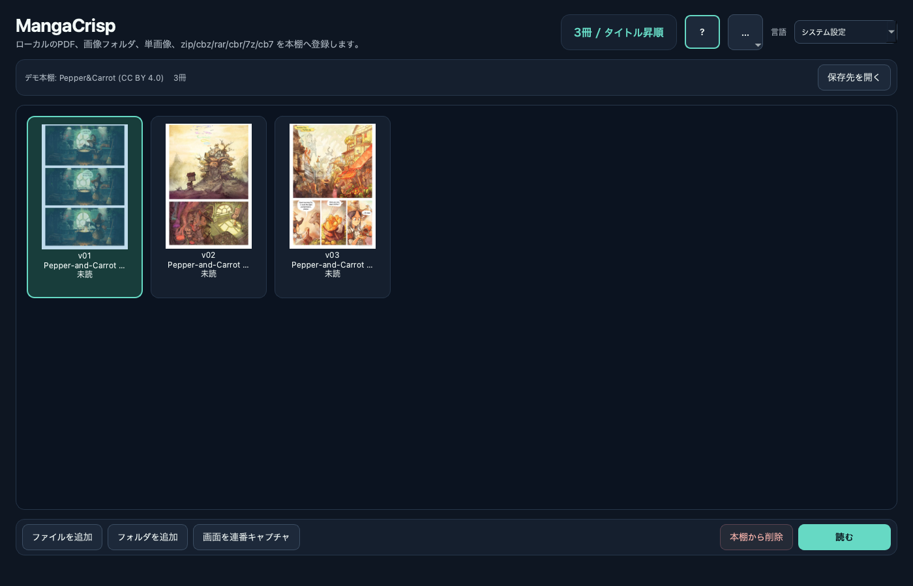
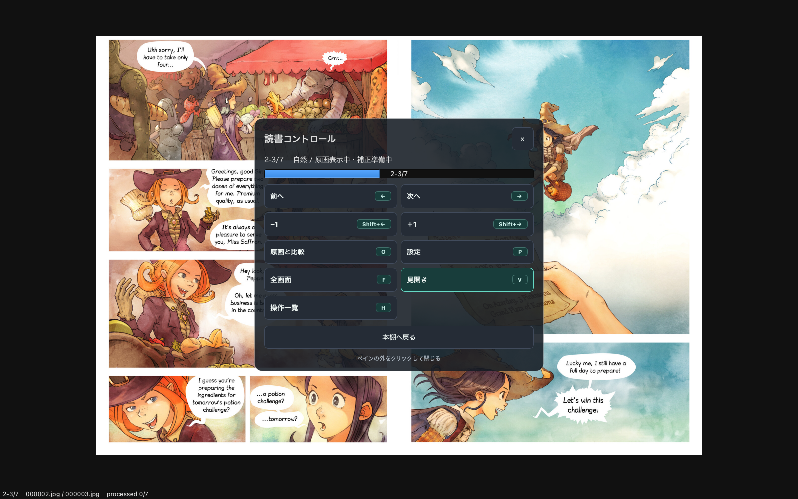
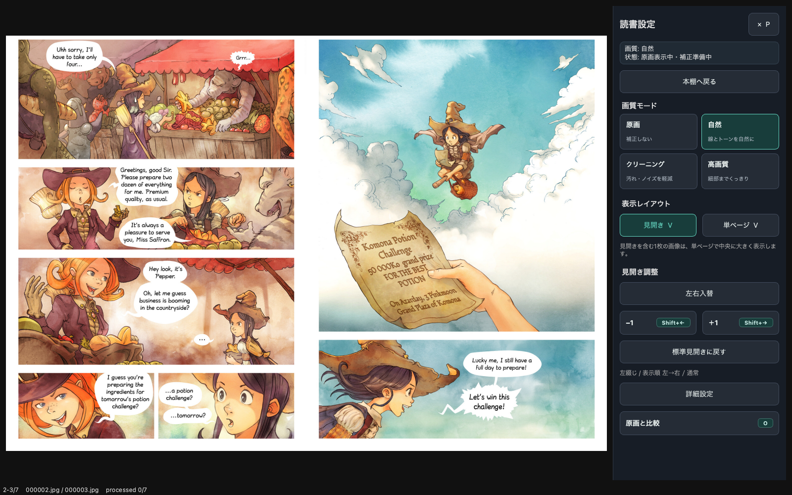
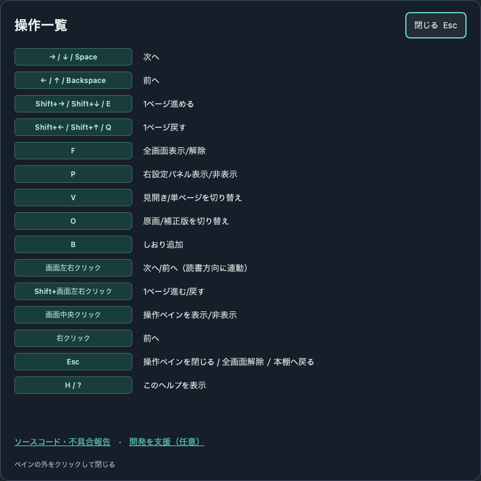

# MangaCrisp

[English](README.md) | [日本語](README.ja.md)

<p align="center">
  
</p>





<details>
<summary>読書設定とショートカット一覧の画面</summary>





</details>

画像はmacOS上の共通UIを、デモ専用の一時本棚で撮影しています。作品はDavid Revoyの
*Pepper&Carrot*（[CC BY 4.0・クレジット](demo/ATTRIBUTION.md)）のみです。
[撮影手順と素材の説明](docs/images/README.md)。

MangaCrispは、macOS／Windows／Linux向けの無料・オープンソース漫画／コミックビューアです。PDF、CBZ、CBR、ZIP、RAR、7z、画像フォルダを読み込み、本棚、右綴じ見開き表示、Real-CUGANによるAI補正を利用できます。

旧称RAIV for macとして[nalltama/RAIV](https://github.com/nalltama/RAIV)に着想を得て独立実装しました。現在はMangaCrispとして独自の製品方針で開発しており、本家RAIVの公式リリースではありません。

## MangaCrispの開発継続を支援する

MangaCrispは個人で開発している、MIT Licenseの無料ソフトウェアです。役立った場合は、
**[Buy Me a Coffeeで今後の開発を任意で支援](https://buymeacoffee.com/jydie5)**
できます。支援はコード署名、Windows／macOS／LinuxのGPU実機検証、ビルドサービス、開発用AI・APIの
費用に充てます。支援による機能解放やライセンス変更はありません。

費用をかけずに、Star、リリースの共有、再現手順付きの不具合報告、異なる実機でのテスト、
コード／文書の改善でも支援できます。
[閲覧状況と支援をどう測るか](docs/development/project-sustainability.ja.md)も公開しています。
送金には、このリポジトリ内に掲載した公式リンクだけを利用してください。

## すぐに使う

一般ユーザーにPython、uv、ターミナル操作は不要です。

### [MangaCrisp macOS版（Apple Silicon）Beta 0.7.1b0.3をダウンロード](https://github.com/jydie5/MangaCrisp/releases/download/macos-beta-0.7.1b0.3/MangaCrisp-v0.7.1b0.3-macos-apple-silicon-standalone.zip)

本棚・読書設定・ヘルプを刷新したmacOSベータです。中央クリックで半透明の操作パネルと
ショートカットを表示できます。高画質補正の偽色と、前後移動時の補正・キャッシュも改善しました。
詳細は[リリース文書](docs/releases/macos-beta-0.7.1b0.3.md)を参照してください。

1. 上のリンクからstandalone ZIPをダウンロードします。
2. ZIPをダブルクリックして展開します。
3. `MangaCrisp.app`を`アプリケーション`フォルダへ移動します。
4. 初回だけ`MangaCrisp.app`をControlキーを押しながらクリックし、`開く`を選びます。

詳しい画面説明と起動できない場合の対処は[INSTALL.ja.md](INSTALL.ja.md)にあります。
過去版とSHA-256チェックサムは
[Releasesページ](https://github.com/jydie5/MangaCrisp/releases)で確認できます。

> 現在のβ版はad-hoc署名済みですが、Apple Developer ID署名・notarizationは未実施です。初回の通常ダブルクリックはmacOSに止められることがあります。

### Windows開発プレビュー

**[Windows 10/11 x64 Preview 0.7.1b0.5をダウンロード](https://github.com/jydie5/MangaCrisp/releases/download/windows-preview-0.7.1b0.5/MangaCrisp-0.7.1b0-windows-x64-portable-preview.zip)**

新しい本棚、画質カード、中央操作パネル、ショートカット一覧、補正・キャッシュ修正を収録しています。
現行UIはWindows実機で動作確認済みです。WindowsのネイティブCIでビルド・配布監査し、
展開後に開発ツールへ依存せず起動することを検証しています。

未署名のポータブルZIPで、Python、uv、CUDA、インストーラーは不要です。
固定したZig版Real-CUGANと7-Zipを同梱します。Intel/AMD実GPUのエンジン一致証跡と
別クリーンアカウントの検証は正式版までの残項目です。
[リリースノート](docs/releases/windows-preview-0.7.1b0.5.md)と
[Windows導入手順](INSTALL.windows.ja.md)を参照してください。

### Linux（Ubuntu）プレビュー

**[Linux x86_64 Preview 0.7.1b0.4をダウンロード](https://github.com/jydie5/MangaCrisp/releases/download/linux-preview-0.7.1b0.4/MangaCrisp-0.7.1b0-linux-x86_64.tar.gz)**

Ubuntu 24.04以降のx86_64向けです。UbuntuのネイティブCIで作成し、新UI/UXと補正・キャッシュの
修正を収録しています。ユーザー単位のインストーラと公式Real-CUGAN Vulkanエンジンを同梱し、
Python、uv、CUDAは不要です。現行UIはLinux実機で動作確認済みです。

previewとして公開しており、検証済みの環境とGPU・セッション別の残項目は各文書に記録しています。
[リリースノート](docs/releases/linux-preview-0.7.1b0.4.md)、
[Linux導入手順](INSTALL.linux.ja.md)、[開発者向け引き継ぎ](docs/development/linux-handover.ja.md)を参照してください。

## 最初の一冊を読む

1. MangaCrispを起動すると本棚が開きます。
2. PDF、ZIP、CBZ、RAR、CBR、7z、CB7、または画像フォルダを本棚へドラッグ＆ドロップします。
3. 確認画面で`登録`を選びます。
4. 表紙をダブルクリックすると読書画面が開きます。
5. 左カーソルキーまたはSpaceで先へ進みます。

元の圧縮ファイルは削除しません。本棚には読書用に展開したコピーを保存します。

## 先行した読書・本棚UX改善

各OSの現在の配布版には、上記の新しい操作パネル・ヘルプ・補正キャッシュ修正に加えて、
以下の先行した改善も含まれます。

**機能**

- 全画面で2秒間操作がないとマウスカーソルを隠します。
- ページ情報オーバーレイの**本棚へ**ボタンで、全画面からでもマウスだけで本棚へ戻れます。
- 本棚で複数選択（Command／Ctrl、Shift）、右クリックメニュー、複数冊の一括削除（確認1回）に対応しました。
- 先読みが読む速さに追従します。後方6ページ、前方はページにとどまる間は6ページまで減り、速く読むと12〜24ページへ戻ります。

**修正**

- 表示中の見開きを先読みより先に補正するため、開いた直後やジャンプ先の見開きが
  12〜24ページ分のキュー待ちになる問題を直しました。
- ページ送りの数秒後に先読みが完了したとき、補正済み表示が一瞬原画へ戻る問題を直しました。
- 管理コピーの削除に失敗した場合はDB登録を残して通知し、他の本の削除成功は反映します。
  元アーカイブは残りますが、失敗した管理コピーは途中まで消える場合があります。

## v0.7.1-betaの新機能

- **macOS／Windows／Linux連番スクリーンキャプチャ:** 許可された画面範囲を手動操作でカラーPNGへ
  連番保存し、確認後にCBZ／ZIPへ完成できます。
- **単ページ表示:** 1画像を画面中央へ最大表示し、1画像ずつ送ります。見開きを
  1枚として撮影した本を、そのまま重複なく読むための表示です。
- **安全な完成処理:** PNGは撮影ごとに即時保存し、保存待ちを完了してから
  アーカイブ化します。同じページ構成を誤って複数回完成することも防ぎます。

初回撮影前に[連番スクリーンキャプチャ](#連番スクリーンキャプチャベータ)を確認してください。
macOSでは[画面収録の許可手順](INSTALL.ja.md#キャプチャ用の画面収録を許可する)も必要です。

## AI補正と原画比較

正式macOS standalone版には、公式の`realcugan-ncnn-vulkan 20220728 macOS`
実行ファイルとモデルを同梱しています。Windows Development Previewには、
固定・監査済みのZig版Windowsエンジンと同じモデルを同梱しています。
どちらも追加セットアップは不要です。

- 読書中は現在の見開きと前後のページをバックグラウンドで自動補正します。
- 読む速さに応じて前方6〜24ページ、後方6ページを先読みします。じっくり読む間は先読みを減らしてGPUを休ませます。
- 完成した補正はキャッシュの容量・保存期間の範囲で残し、前のページへ戻ったときに再利用します。
- PDF・ZIPも、同じファイルを開き直したときに補正済みキャッシュを再利用します。
- 補正エラーで自動処理が止まった場合も、ページ移動や画質設定の変更で再試行します。
- `P`キーで読書設定を開きます。
- `原画を表示（OFFで補正版）`をONにすると原画、OFFにすると補正版です。
- `状態: 補正済み`になる前は、切り替えても同じ原画が表示される場合があります。
- 縦2234px以上の画像は標準設定では補正を省略します。

macOS版の補正処理はApple Silicon GPUをVulkan/Metal経由で使用します。
Windows版はVulkan対応GPUを使用します。補正を待っている間も原画で読み進められます。

## 画質モード

通常は`かんたん`モードで次の4種類から選びます。

| モード | 用途 |
|---|---|
| 原画 | 補正せず元画像を表示 |
| 自然 | 線とトーンを自然に整える標準設定 |
| クリーニング | 古いスキャンや圧縮荒れを強めに抑える |
| 高画質 | 処理時間より仕上がりを優先 |

高画質モードは、一部のページで色が崩れる問題を防ぐため、タイル間の計算を正確に
同期します。エンジン既定の近似処理より時間がかかります。修正前の高画質キャッシュは
自動的に作り直されます。

`マニュアル`へ切り替えると、モデル、倍率、noise、tile、TTA、補正スキップ解像度を変更できます。調整した組み合わせには名前を付けて保存し、次回起動後も呼び出せます。

## 主な機能

- 表紙を並べる本棚
- 複数アーカイブのドラッグ＆ドロップ登録、複数選択、右クリックの読む／削除
- macOS／Windows／Linuxの固定範囲をカラーPNGとCBZ／ZIPへ保存する連番キャプチャ
- PDF、ZIP/CBZ、RAR/CBR、7z/CB7、画像フォルダ
- 全ページ変換を行わず、必要なページだけカラー保持で描画するPDF対応
- 上限付きPDF描画／AI補正キャッシュとキャッシュ削除操作
- 不具合報告に使える個人情報を含まない診断情報のコピー
- 右綴じ漫画の表紙単独・見開き表示
- 見開き撮影画像を1枚ずつ中央表示する単ページ表示
- 巻順の並び替えと次巻への移動
- 読書位置の保存
- 全画面表示と透過進捗オーバーレイ
- Real-CUGANの自動先読み補正
- 読書速度に応じた適応先読み
- 非同期画像デコードと原画フォールバックによる即時ページ送り
- かんたん／マニュアル画質設定とカスタム設定保存
- 原画と補正版の即時切り替え
- 本棚からの削除と保存先表示
- OS言語に追従する英語／日本語UI

開発中の機能、既知の改善項目、実装順は[ROADMAP.md](ROADMAP.md)で確認できます。

## 表示言語

初期状態ではmacOS／Windowsの優先言語に従います。本棚右上の`言語`から`システム設定`、
`英語`、`日本語`を選択できます。変更後にMangaCrispを再起動すると、本棚、ビューワ、
確認画面、ヘルプ、状態表示が同じ言語へ切り替わります。

## キーボード操作

右綴じ漫画の標準設定です。

| キー | 動作 |
|---|---|
| `←` / `Space` | 次の見開き |
| `→` | 前の見開き |
| `Shift + ←` | 1ページ先へずらす |
| `Shift + →` | 1ページ前へずらす |
| `V` | 見開き（2画像）／単ページ（1画像）を切り替え |
| `F` | 全画面 |
| `P` | 読書設定の表示／非表示 |
| `O` | 原画／補正版を切り替え |
| `H` / `?` | ショートカット一覧とプロジェクトリンク |
| `Esc` | 操作ペインを閉じる／全画面解除／本棚へ戻る |

画面中央をクリックすると、移動ボタンとキー案内を備えた半透過の操作ペインを表示します。
`P`（設定）、`O`（原画と比較）、`F`（全画面）、`V`（見開き／単ページ）、
`Shift`＋矢印（1ページ移動）を確認できます。下部の操作バーは常時表示せず、
ペインを閉じている間もキーボードショートカットを使えます。
`H`の操作一覧も同じデザインです。`Esc`、閉じるボタン、またはパネルの外側クリックで
閉じられ、そのクリックでページが移動することはありません。

## マウス操作

クリック領域は読書方向に連動し、ウインドウ表示と全画面表示で同じように動作します。

| 操作 | 動作 |
|---|---|
| 進行方向側40%をクリック | 次の見開き |
| 戻る方向側40%をクリック | 前の見開き |
| `Shift` + 左右領域クリック | 1ページ進む／戻す |
| 中央20%をクリック | 半透明の読書コントロールを表示／非表示。外側クリックで閉じる |
| 右クリック | 前の見開き |
| 読書コントロールの`本棚へ`ボタン | 読書位置を保存して本棚へ戻る |

中央クリックで半透明の読書コントロールを表示／非表示にします。前へ／次へ、1ページ戻す／進む、
原画と比較、設定、全画面、本棚、ヘルプを選べます。ペインの外をクリックして閉じます。

右綴じ漫画は左側クリックで進み、右側クリックで戻ります。左綴じコミックでは逆になります。
ドラッグ操作ではページを送りません。全画面では2秒間操作がないとマウスカーソルが消え、
マウスを動かすかキーを押すとすぐに戻ります。

画面キャプチャなどで1画像の中に見開きが含まれている場合は、読書設定の
`単ページ（1画像）`を選びます。画像を中央に大きく表示し、通常のページ送りも
1画像ずつ進みます。`V`キーで見開き表示と即時に切り替えられます。

## 連番スクリーンキャプチャ（ベータ）

自分が権利を持つ画面、または保存を許可された画面だけに使用してください。
MangaCrispは自動ページ送りや画面保護の回避を行いません。

1. 本棚の`画面を連番キャプチャ`を開きます。
2. セッション名と保存先を決め、撮影範囲を選びます。
3. `撮影を開始`を押します。macOSの初回だけ`画面収録とシステムオーディオ録音`で
   MangaCrispを許可し、アプリを完全終了して同じアプリを開き直します。
   LinuxのWaylandでは、スクリーンショットとショートカットの確認ダイアログを許可します。
4. 対象アプリでページを手動で送り、画像ごとにmacOSは`Option+C`、Windows／Linuxは
   `Alt+C`を1回押します。直前の撮影取消は`Option+Z`または
   `Alt+U`です。Windows／Linuxでは他アプリと競合する場合に別プリセットも選べます。
5. Windows／Linuxではタスクバー（Dash）に最小化されたMangaCrispをクリックし、macOSではDockから
   MangaCrispを開いて管理画面を戻し、`撮影を完了`を押します。
   元の連番PNGは完成したCBZ／ZIPと同じセッションフォルダへ残ります。

撮影画像はローカルへ保存し、外部へ送信しません。1回の撮影に見開き全体が
含まれる場合は、完成した本を開いて`V`キーで単ページ表示へ切り替えてください。
権限設定と復旧手順は[INSTALL.ja.md](INSTALL.ja.md)に記載しています。

## 保存場所

- 本棚データ: 新規利用者は`~/MangaCrisp Library`
- PDF描画／AI補正キャッシュ: `~/Library/Caches/MangaCrisp`
- 本棚データベース: `~/Library/Application Support/MangaCrisp`

Windowsの保存場所は[INSTALL.windows.ja.md](INSTALL.windows.ja.md)、Linuxの保存場所は
[INSTALL.linux.ja.md](INSTALL.linux.ja.md)に記載しています。

本棚データは意図して作る読書用コピーです。アーカイブは元ファイルと展開済みページ、
PDFは元ファイルと表紙を管理するため、元の本と同程度、処理中はそれ以上の容量になる場合が
あります。本棚から本を削除すると管理コピーと読書状態を削除しますが、元のZIP、RAR、PDFは
削除しません。

PDF描画キャッシュとAI補正キャッシュは破棄可能です。それぞれ2 GiBを上限に整理しますが、
表示中・処理中のページを保護する間は上限を超える場合があります。30日以上使っていない項目は
読書画面を開いたときに整理し、AI補正キャッシュは読書中も自動整理します。本棚の`キャッシュを削除`を使えば
両方を即時に削除できます。本棚データベースはメタデータ中心で通常は小さく、スキーマ更新時
だけ1回限りのバックアップが残る場合があります。中断された取り込みデータは次回起動時に
削除または復元します。

連番キャプチャのセッションフォルダとPNGは、指定した保存先に作る利用者の成果物です。
キャッシュではないため、MangaCrispは自動削除しません。

旧RAIV for macを利用していた場合、初回起動時に設定、データベース、AIキャッシュと
旧既定の`~/RAIV Library`を新名称の保存先へ移行します。本棚フォルダはコピーせず、
同じディスク上で名前を変更するため、本や読書位置を保ったまま短時間で移行できます。
ユーザーが選択したカスタム保存先は変更しません。

## アンインストール

1. `MangaCrisp.app`をゴミ箱へ移動します。
2. 本棚も不要なら設定中の本棚保存先を削除します。
3. 補正キャッシュも不要なら`~/Library/Caches/MangaCrisp`を削除します。

元のZIP/RARはMangaCrispのアンインストールでは削除されません。

## 現在の制限

- 正式macOS版はApple Silicon専用で、Intel Macには対応していません。
- Windows x64版はDevelopment Previewで、Intel／AMD／別アカウントの
  リリース証跡が未完了です。
- Linux版はUbuntu 24.04以降のx86_64向けプレビューです。他のディストリビューションと
  aarch64は検証していません。
- 各OS版とも未署名で、macOS版はApple notarizationも未実施です。
- β版のためUIと設定の互換性が変わる可能性があります。
- RAR形式によってはmacOS側の展開機能との相性で開けない場合があります。
- 自動アップデートは未実装です。新しいZIPをReleasesから取得してください。

## ソースコードから起動する

この項目は開発者向けです。一般ユーザーはstandalone版を利用してください。

### 未リリースsourceの状態

以下はsource開発用の状態で、ダウンロード版、既存のスクリーンショット、配布binaryを更新するものではありません。
F03〜F06は`main`へ統合済みです。F07/#70とF08/#71はDraft・先行PR検証待ちです。
現在の境界は[次期機能引き継ぎ](docs/development/next-features-handover.md)を参照してください。

- **F03 — 本棚の検索・並べ替え:** タイトル検索、自然順、最終閲覧順、追加順に対応し、「最近読んだ本」は最終閲覧の降順で表示します。
- **F04 — 物理ページ番号ジャンプ:** 右綴じ／左綴じと見開き境界を保ったまま、物理ページ番号へ移動します。
- **F05 — しおり:** `B`で現在ページを追加し、`Shift+B`で一覧を開いて移動・削除します。同じ本の同じページは二重追加しません。
- **F06 — 本ごとの読書状態:** レイアウトと画質設定を本ごとに復元します。`O`の原画／補正版比較は一時的な読書操作です。
- **F07 / #70 — ビューポートDraft:** `+` / `-`、`0`全体、`W`幅、`1`実寸、`Ctrl`／`Meta`＋ホイール、ドラッグパンを実装済みですが、先行検証とmain統合待ちです。
- **F08 / #71 — ページ一覧Draft:** `T`で可視範囲だけを要求し、source PNG生成、全体展開、AI補正を起こしません。thumbnail LRUは16MiB、画面外アイコンは解放します。実装済みですが、先行検証とmain統合待ちです。
- **F13 / #72 — EPUB Stage A:** metadata検査だけで、UI/importer/factory/page sourceは未接続です。EPUBはまだ読めません。[EPUB Stage A引き継ぎ](docs/development/epub-probe-handover.md)を参照してください。

```bash
git clone https://github.com/jydie5/MangaCrisp.git
cd MangaCrisp
uv sync --extra gui
uv run mangacrisp
```

Python不要のローカルアプリを作る場合:

```bash
uv sync --extra app
uv run --extra app python scripts/build_macos_app.py --bundle-engine
```

ビルド時に公式Real-CUGAN macOS ZIPをGitHub Releasesから取得し、SHA256を検証してから同梱します。ローカルの未知のバイナリは使用しません。

補正やキャッシュを変更する場合は、[処理の役割分担](docs/development/correction-pipeline.md)も参照してください。
開発用テスト:

```bash
uv sync --extra dev
uv run pytest
```

## ライセンス

MangaCrisp本体はMIT Licenseです。同梱するReal-CUGANと依存物の由来、バージョン、ライセンスは[THIRD_PARTY_NOTICES.md](THIRD_PARTY_NOTICES.md)に記載しています。standaloneアプリ内にもライセンス全文を収録します。

## 自由ライセンスのデモ本

[`demo`](demo)には、本棚へそのままドロップできる小さなZIPを3冊収録しています。
David Revoy氏による*Pepper&Carrot*第1〜3話の英語・低解像度版で、各ZIP内にも
作者名、出典、CC BY 4.0の表示を収録しています。
