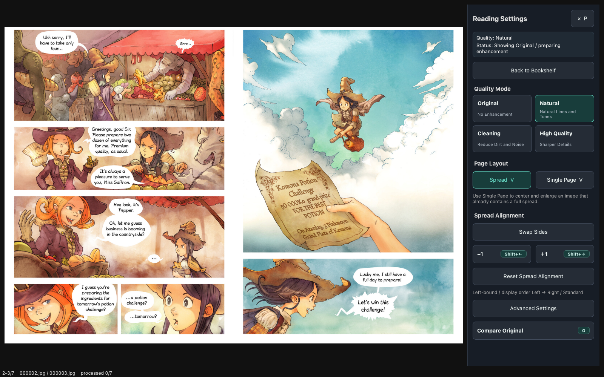

# MangaCrisp

[English](README.md) | [日本語](README.ja.md)

<p align="center">
  
</p>

MangaCrisp is a free, open-source manga and comic viewer for macOS, Windows, and Linux.
It reads PDF, CBZ, CBR, ZIP, RAR, 7z, image folders, and individual
images, combining a visual bookshelf, two-page manga reading, and automatic
Real-CUGAN AI upscaling in a native desktop application.

MangaCrisp began as RAIV for mac, an independent implementation inspired by
[nalltama/RAIV](https://github.com/nalltama/RAIV). It is not an official release
of the original RAIV project and now follows its own product direction.




The screenshots use *Pepper&Carrot* by David Revoy under
[CC BY 4.0](demo/ATTRIBUTION.md). No commercial manga pages are included.

## Help keep MangaCrisp moving

MangaCrisp is independent, free MIT-licensed software. If it is useful to you,
**[support continued development on Buy Me a Coffee](https://buymeacoffee.com/jydie5)**.
Support helps pay for code signing, Windows/macOS/Linux GPU validation, build
services, and development AI/API usage. It never unlocks features or changes
the license.

You can also help at no cost: star the repository, share a release, report a
reproducible bug, test on different hardware, or improve code and documentation.
See [how project reach and support are measured](docs/development/project-sustainability.md).
Trust only funding links published in this repository.

## Download

The standalone build does not require Python, uv, or Terminal.

### [Download MangaCrisp for macOS (Apple Silicon) — Beta 0.7.1b0.3](https://github.com/jydie5/MangaCrisp/releases/download/macos-beta-0.7.1b0.3/MangaCrisp-v0.7.1b0.3-macos-apple-silicon-standalone.zip)

This macOS beta refreshes the bookshelf, reading settings, and shortcut help.
Center-click controls show navigation and keyboard shortcuts on demand. It also
fixes false colors in high-quality correction and improves cache reuse during
forward/back movement. See the
[release notes](docs/releases/macos-beta-0.7.1b0.3.md).

1. Download the standalone ZIP from the link above.
2. Unzip it and move `MangaCrisp.app` to Applications.
3. On first launch, Control-click `MangaCrisp.app` and choose **Open**.

The current beta is ad-hoc signed, without Apple Developer ID signing or notarization. See
[INSTALL.md](INSTALL.md) for detailed installation and troubleshooting steps.
All versions and the SHA-256 checksum are available on the
[Releases page](https://github.com/jydie5/MangaCrisp/releases).

### Windows development preview

**[Download the Windows 10/11 x64 Development Preview](https://github.com/jydie5/MangaCrisp/releases/download/windows-preview-0.7.1b0.4/MangaCrisp-0.7.1b0-windows-x64-portable-preview.zip)**

The unsigned portable ZIP needs no Python, uv, CUDA, or installer. It bundles
the audited Zig-built Real-CUGAN engine and has passed interactive validation
on NVIDIA graphics. Version 0.7.1 adds manual fixed-region sequential capture
with Windows global capture/undo shortcuts and the Single Page reader layout.
Intel and AMD enhancement evidence and a separate clean Windows account test
remain before the stable Windows release. Original-image reading remains
available if enhancement is unavailable. See
[INSTALL.windows.md](INSTALL.windows.md) for installation and limitations.

> The source now includes the UI/UX and correction/cache fixes released in
> macOS Beta 0.7.1b0.3. This Windows download predates them. Native Windows
> acceptance of the new controls and help is pending; previous candidate
> checks do not certify the new UI. See the
> [developer handover](docs/development/windows-handover.md).

### Linux (Ubuntu) preview

**[Download MangaCrisp for Linux x86_64 (Preview 0.7.1b0.3)](https://github.com/jydie5/MangaCrisp/releases/download/linux-preview-0.7.1b0.3/MangaCrisp-0.7.1b0-linux-x86_64.tar.gz)**

Ubuntu 24.04 or newer on x86_64 is supported as a one-folder `tar.gz` build
with a per-user installer (no root needed), or from source. It bundles the official Real-CUGAN
Ubuntu engine (Vulkan) and supports sequential capture on GNOME Wayland and
X11. See [INSTALL.linux.md](INSTALL.linux.md) for required packages,
installation, and capture permissions. Linux is new: if it works on your GPU,
please report it, and consider [supporting AMD/Intel test hardware](https://buymeacoffee.com/jydie5).

Preview 0.7.1b0.3 includes the reader/bookshelf UX improvements and fixes for
corrected-display flashing and managed-copy removal errors. It passed clean
Ubuntu 24.04/26.04 validation and a GNOME Wayland human check. AMD/Intel GPUs,
a physical X11 session and fractional scaling remain unverified. See the
[release notes](docs/releases/linux-preview-0.7.1b0.3.md).
The newer controls/help redesign and correction/cache fixes in macOS Beta
0.7.1b0.3 are not in this Linux package; native verification is tracked in the
[Linux handover](docs/development/linux-handover.md).

## Read your first book

1. Launch MangaCrisp to open the bookshelf.
2. Drag a PDF, ZIP, CBZ, RAR, CBR, 7z, CB7, image folder, or image onto the window.
3. Confirm the import.
4. Double-click the cover.
5. Press Left Arrow or Space to advance in the default right-bound mode.

MangaCrisp keeps the source archive untouched. New installations store an
extracted reading copy in `~/MangaCrisp Library`. For existing RAIV for mac
users, the previous default `~/RAIV Library` is renamed to this location on
first launch. A custom library location selected by the user is left unchanged.

## Reader and bookshelf UX update (Linux preview 0.7.1b0.3)

The Linux preview and macOS Beta 0.7.1b0.3 include the following changes.
They were also accepted in an earlier local Windows candidate; the Windows
download above still predates this update.

**Features**

- Fullscreen hides the mouse cursor after two seconds of no input.
- A **Bookshelf** button on the reading-information overlay returns to the
  bookshelf by mouse, including from full screen.
- The bookshelf supports multi-select (Command/Ctrl and Shift), a right-click
  menu, and removing several books with one confirmation.
- Prefetch follows the reader's pace: six pages behind, and the forward window
  shrinks to six pages while you linger on a page and grows back to 12-24 when
  you read faster.

**Fixes**

- The spread you are looking at is corrected before the lookahead pages, so a
  newly opened or jumped-to spread no longer waits behind 12-24 queued pages.
- A corrected spread no longer flashes to the original image a few seconds
  after a page turn when the background prefetch finishes.
- Managed-copy deletion failures are reported before removing the book's
  database entry; successful deletions of other books are retained. Source
  archives are preserved, though a failed managed copy may be partly removed.

## New in v0.7.1-beta

- **Sequential screen capture for macOS, Windows, and Linux:** manually save an authorized screen
  region as numbered color PNG files, review the pages, and finish as CBZ or ZIP.
- **Single Page layout:** center one image at full reader width and advance one
  image at a time. This is intended for captures where one image already
  contains a complete two-page spread.
- **Reliable capture completion:** each PNG is saved immediately, pending saves
  finish before packaging, and the same page set cannot be packaged twice.

See [Sequential screen capture](#sequential-screen-capture-beta) before the
first capture. macOS users must also follow the
[screen-recording permission guide](INSTALL.md#allow-screen-recording-for-capture).

## Features

- Cover-based bookshelf with multi-file drag and drop, multi-select, and right-click read/remove
- Sequential fixed-region screen capture to color PNG and CBZ/ZIP on macOS, Windows, and Linux
- PDF, ZIP/CBZ, RAR/CBR, 7z/CB7, image folders, and individual images
- On-demand PDF rendering that preserves color without converting the whole book during import
- Bounded PDF render and AI enhancement caches with a clear-cache action
- Copyable privacy-safe diagnostics for issue reports
- Right-bound manga layout with a single cover and two-page spreads
- Single Page layout for one-image spreads and captured pages
- Natural title and volume ordering
- Continue to the next volume without leaving full screen
- Reading-position persistence
- Full-screen reading with a translucent progress overlay
- Automatic Real-CUGAN enhancement around the current reading position
- Adaptive forward prefetch and a revolving backward cache
- Non-blocking image decoding with immediate original-image fallback
- Simple quality modes and saved manual presets
- Instant original/enhanced comparison
- Managed library removal without deleting the source archive
- English and Japanese UI with operating-system language detection

See [ROADMAP.md](ROADMAP.md) for planned work and known improvement areas.

## Language

MangaCrisp follows the operating-system language preference on macOS and
Windows. English and Japanese are included. Use the **Language** selector in the
bookshelf header to choose **System**, **English**, or **Japanese**. Restart
MangaCrisp after changing it so the bookshelf, reader, dialogs, help, and status
messages all use the same language.

## AI enhancement

The stable macOS standalone package bundles the official
`realcugan-ncnn-vulkan 20220728 macOS` executable and models. The Windows
Development Preview bundles the pinned, audited Zig-built Windows engine and
the same models. Both need no additional engine setup.

MangaCrisp automatically processes the visible spread and nearby pages in the
background, normally preparing 6-24 pages ahead and six pages behind.
Completed corrections stay on disk within the cache size and age limits, so
returning to an earlier page can reuse them. Original pages remain available
immediately while enhancement catches up. After a processing error, moving to
another page or changing quality settings allows automatic correction to retry.
PDF and ZIP corrections are also reused after reopening the same source.

Press `P` to open Reading Settings. Enable **Show original** to view the source
page; disable it to return to the enhanced page. Pages at or above the default
2234-pixel height threshold are left unchanged.

### Quality modes

| Mode | Purpose |
|---|---|
| Original | Display the source image without enhancement |
| Natural | Balance line clarity and screentone preservation |
| Cleaning | More strongly reduce scan and compression artifacts |
| High quality | Prioritize output quality over processing time |

High quality uses accurate tile synchronization to prevent false colors on
some pages. This takes longer than the engine's default approximation. Older
high-quality caches are regenerated automatically after this fix.

Manual mode exposes model, scale, noise, tile size, TTA, and the resolution
threshold. Custom combinations can be named and reused.

## Keyboard controls

These are the defaults for right-bound manga.

| Key | Action |
|---|---|
| `Left` / `Space` | Next spread |
| `Right` | Previous spread |
| `Shift + Left` | Shift one page forward |
| `Shift + Right` | Shift one page backward |
| `V` | Toggle Spread (2 images) / Single Page (1 image) |
| `F` | Toggle full screen |
| `P` | Show or hide Reading Settings |
| `O` | Toggle Original / Enhanced |
| `H` / `?` | Show keyboard help and project links |
| `Esc` | Close the controls panel, exit full screen, or return to the bookshelf |

Click the center of the page to open the translucent controls panel. It shows
navigation buttons and shortcut badges for `P` (settings), `O` (original comparison),
`F` (full screen), `V` (layout), and `Shift` + arrow keys (one-page movement).
There is no persistent controls bar; keyboard shortcuts remain available while reading.
The `H` help panel uses the same design and closes with `Esc`, its Close button,
or a click outside the panel. Dismissing it does not turn a page.

## Mouse controls

The click zones follow the selected reading direction and work the same in
windowed and full-screen reading.

| Input | Action |
|---|---|
| Click the forward-side 40% | Next spread |
| Click the backward-side 40% | Previous spread |
| `Shift` + side click | Move one page forward or backward |
| Click the center 20% | Show or hide the translucent reading controls panel; click outside it to close |
| Right-click | Previous spread |
| **Bookshelf** button in the reading controls panel | Save the position and return to the bookshelf |

Click the center to show or hide the translucent reading controls panel. It includes
previous/next navigation, one-page movement, original/enhanced comparison,
settings, full screen, bookshelf, and help. Click outside the panel to close
it.

For right-bound manga, the left side advances and the right side goes back.
Left-bound comics use the opposite mapping. Dragging does not turn a page.
In full screen the mouse cursor disappears after two seconds without input
and comes back as soon as you move the mouse or press a key.

When one captured image already contains a complete two-page spread, choose
**Single Page (1 image)** in Reading Settings. MangaCrisp centers that image,
uses the full reader width, and advances one image at a time. Press `V` to
toggle between single-page and normal spread layouts.

## Sequential screen capture (beta)

Use this feature only for screens you own or are authorized to save. MangaCrisp
does not automate page turning or bypass capture protection.

1. In the bookshelf, choose **Sequential Screen Capture**.
2. Name the session, choose an output folder, and select the capture region.
3. Start capture. On first use on macOS, allow MangaCrisp under **Screen & System
   Audio Recording**, quit the app completely, then reopen the same installed app.
   On Linux Wayland, allow the screenshot and shortcut dialogs.
4. Turn pages in the source application and press `Option+C` on macOS or
   `Alt+C` on Windows and Linux once per image. Use `Option+Z` or
   `Alt+U` to undo the last capture. Windows and Linux also provide alternative
   presets when another application owns either shortcut.
5. On Windows and Linux, the controller remains minimized in the taskbar or
   Dash; click its app icon to restore it. On macOS, open MangaCrisp from the
   Dock. Then choose
   **Finish Capture**. The numbered source PNGs remain beside the finished CBZ/ZIP.

Capture images are stored locally and are not uploaded. If each capture already
contains a full spread, open the finished book and press `V` for Single Page
layout. Full permission and recovery steps are in [INSTALL.md](INSTALL.md).

## Free demo books

The [`demo`](demo) directory contains three small ZIP files that can be dropped
directly onto the bookshelf. They contain the English low-resolution exports of
the first three *Pepper&Carrot* episodes. Art and story are by David Revoy, and
the files are redistributed under CC BY 4.0 with attribution included both
beside and inside every archive.

## Storage and removal

- Managed reading copies: `~/MangaCrisp Library` for new installations
- PDF render and AI enhancement caches: `~/Library/Caches/MangaCrisp`
- Database and settings: `~/Library/Application Support/MangaCrisp`

Windows locations are listed in [INSTALL.windows.md](INSTALL.windows.md) and
Linux locations in [INSTALL.linux.md](INSTALL.linux.md).

The managed library is an intentional reading copy: an imported archive keeps
its original file plus extracted pages, while a PDF keeps its original and
cover. It can therefore be close to, or temporarily larger than, the source
books. Removing a book from the bookshelf deletes that managed copy and its
reading state, but never deletes the source ZIP, RAR, or PDF.

PDF render and AI enhancement caches are disposable. Each cache is limited to
2 GiB, except while protecting pages currently in use or being processed.
Entries unused for more than 30 days are removed when the reader opens; AI
cache maintenance also runs during reading. **Clear Cache** removes both
immediately. The database contains bookshelf
metadata and is normally small; a one-time backup can be retained when its
schema is upgraded. Interrupted imports are cleaned up or restored on the next
launch.

Sequential-capture session folders and numbered PNG files are user-created
documents in the destination you selected. They are not caches and MangaCrisp
does not delete them automatically. To uninstall the app, remove
`MangaCrisp.app`; remove the locations above only if you also want to erase the
bookshelf and cache.

On first launch, MangaCrisp migrates the previous settings, database, AI cache,
and default managed-library folder to the MangaCrisp locations. The library
folder is renamed on the same disk rather than copied. Existing books and
reading positions are preserved.

## Current limitations

- The stable macOS beta supports Apple Silicon only; Intel Macs are not
  currently supported.
- The Windows x64 build is a Development Preview with Intel, AMD, and clean
  account release evidence still pending.
- The Linux build targets Ubuntu 24.04+ on x86_64 and is a preview; other
  distributions and aarch64 are not validated.
- The builds are unsigned; the macOS beta is also not notarized.
- Some RAR variants may not be compatible with the available macOS extraction
  backend.
- Updates are manual; download a newer build from Releases.

## Build from source

```bash
git clone https://github.com/jydie5/MangaCrisp.git
cd MangaCrisp
uv sync --extra gui
uv run mangacrisp
```

Build a local standalone application:

```bash
uv sync --extra app
uv run --extra app python scripts/build_macos_app.py --bundle-engine
```

The build script downloads the official Real-CUGAN macOS archive, verifies its
SHA-256 digest, and bundles it. Unknown local binaries are not substituted.

See [correction and cache ownership](docs/development/correction-pipeline.md)
before changing reader scheduling or cache behavior. Run the development test suite:

```bash
uv sync --extra dev
uv run pytest
```

## License

MangaCrisp is licensed under the [MIT License](LICENSE). Real-CUGAN and other
bundled dependencies are documented in
[THIRD_PARTY_NOTICES.md](THIRD_PARTY_NOTICES.md). Demo artwork has its own
[CC BY 4.0 attribution](demo/ATTRIBUTION.md) and is not covered by the MIT
license.
