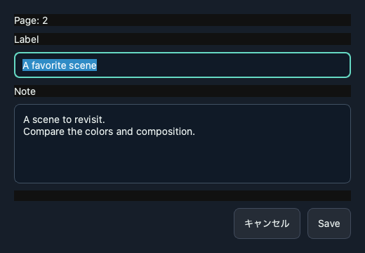

# MangaCrisp for macOS — Beta 0.7.1b0.5

Reading status, record backups, and bookmark notes now ship on Apple Silicon.
The product version remains `0.7.1b0`. This package uses the accepted Mac build
from `main` at `b062ddabafc4ead8ecf6ac7cf639a87ecfee90d8`; the release tag
`macos-beta-0.7.1b0.5` identifies that source. Later gallery and handover changes
are documentation and screenshot tooling only.

## Changes

- Filter All / Unread / Reading / Completed together with title search and
  Recently read. Mark the visible selected books completed or unread in bulk.
- Completion is manual and survives rereading. Mark unread resets the position
  to page one while retaining bookmarks, display settings and last-opened history.
- Export and restore a versioned JSON backup of reading positions, status,
  history, per-book settings and bookmarks. Restore previews matching/skipped
  records and defaults to Cancel. A failed restore rolls back completely.
- Backups restore existing IDs in the same library. They do not include comic
  files, caches, source paths or global settings, and do not migrate reimported
  books between PCs. Titles and user-written notes remain personal data.
- Edit bookmark labels and multiline plain-text notes from `Shift+B`. Cancel or
  Escape leaves the note unchanged; a failed save retains the entered text.
- Restore adds missing bookmarked pages and retains notes on existing pages.
  Repeating a restore does not duplicate bookmarks or undo later note edits.
- Built-in actions, shortcut badges and help share a common action module.
  User-editable key bindings are not included yet.
- Re-adding the same source with the same book ID preserves reading status,
  last-opened history, position and bookmarks.
- When appending a missing JSON extension would target an existing backup,
  export asks before overwriting the actual destination.

Comic EPUB reading is not included. Existing lazy PDF/ZIP, page overview,
zoom/pan and correction behavior is retained.

## Clean demo gallery

Artwork is David Revoy's *Pepper&Carrot*, CC BY 4.0. Images use only an isolated
temporary demo library and generated notes. See [attribution](../../demo/ATTRIBUTION.md)
and [capture procedure](../images/README.md). The gallery does not compare AI quality.

## Validation and platform handover

- The accepted Mac source passed **414 tests, 8 skips and 12 subtests**.
- The actual app passed isolated startup, generated color PDF, page navigation,
  Shift+arrow, layout switching, page overview, H help and full-screen checks.
- The bundled engine ran a generated RGB fixture on the Mac GPU, produced the
  expected 2× dimensions and retained color. This is not all-hardware coverage.
- Engine hash/provenance, 36 model-path entries, required licenses and ad-hoc
  code signature passed the distribution audit. The ZIP is checked again after
  extraction, independently of the build directory.
- The user accepted the integrated Mac candidate as generally satisfactory and
  authorized this release. Earlier isolated native checks also covered bulk
  status, backup cancellation/restoration, notes and same-ID reimport.
- Windows Preview 0.7.1b0.7 already includes the shared features. Its assets are
  unchanged. Linux Preview 0.7.1b0.4 predates them and still needs a Linux build
  and desktop acceptance. See [Windows handover](../development/windows-handover.md)
  and [Linux handover](../development/linux-handover.md).
- This is an **ad-hoc signed, non-notarized Apple Silicon beta**. Developer ID,
  notarization, Windows GPU/clean-account and Linux Wayland/X11 gates are separate.

## Install or roll back

Download `MangaCrisp-v0.7.1b0.5-macos-apple-silicon-standalone.zip` and its
`.sha256` file from the release, verify the checksum, and replace the app.
Python and uv are not required. Follow [installation help](../../INSTALL.md)
for macOS first-launch handling. Previous release assets remain available.

## 日本語

読了状態・読書記録バックアップ・しおりメモをMac版へ収録しました。
本棚で未読／読書中／読了を絞り込み、選択した本をまとめて変更できます。
読了の本は読み返しても読了を維持し、未読へ戻すと位置だけ先頭へ戻します。

本棚の「…」から同じ本棚の読書記録をJSONへ保存・復元できます。復元前に件数を示し、
取消では変更しません。漫画本体・全体設定・cacheは含めず、別PCへの引越し用ではありません。
既存しおりのメモを古い内容へ上書きせず、未登録ページだけを追加します。
Shift+Bからラベルとメモを編集でき、同じIDの原本を再登録しても履歴が残ります。

414テストとMac実アプリ・実GPU・配布監査・展開後起動の確認を行い、利用者の承認を受領しました。
画像は一時的なデモ本棚と再配布可能な作品だけで撮影し、個人の本棚を使っていません。
Apple Silicon向けのad-hoc署名ベータで、Developer ID署名・notarizationは未実施です。
Windows b0.7は公開済み、Linux b0.4の配布物は未更新です。Comic EPUBは含めません。
