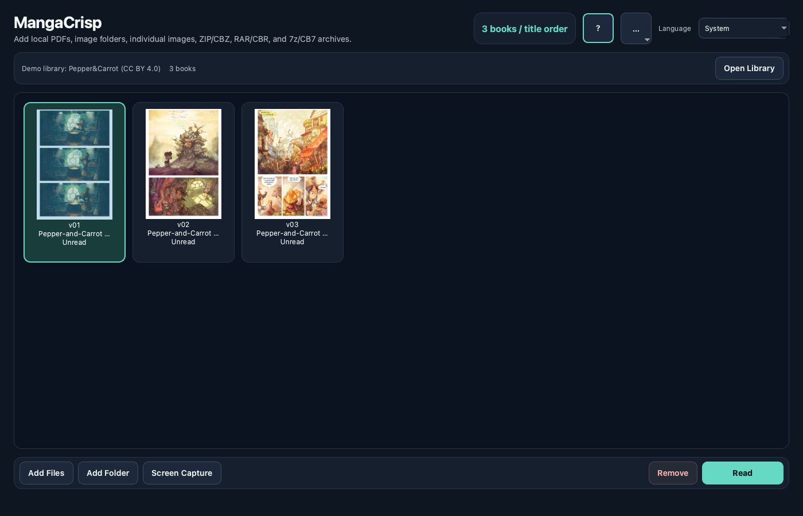
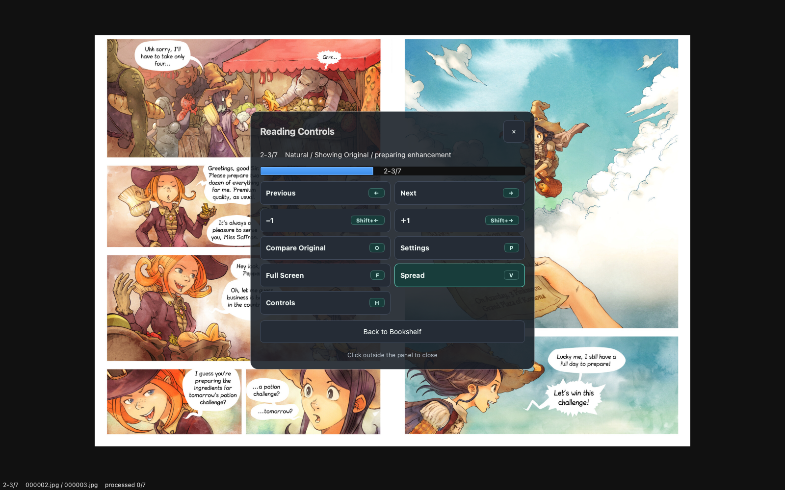

# MangaCrisp for Windows — Development Preview 0.7.1b0.5

UI/UX features and minor bug fixes for Windows 10/11 x64. Product version
remains `0.7.1b0`; the preview tag identifies this new package.

## Changes

- Refreshed navy/teal bookshelf with clearer selection and Read/Import/Remove buttons.
- Quality cards and layout buttons in Reading Settings.
- Center-click translucent controls for navigation, original comparison, settings,
  fullscreen, and bookshelf return, with visible keyboard shortcuts. No permanent
  bottom controls bar.
- Redesigned H/? shortcut help closes by button, Escape, or an outside click,
  without turning a page or leaving fullscreen.
- Accurate pro-model tile synchronization prevents false colors. Old pro cache
  entries are regenerated automatically.
- Correction scheduling and cache reuse handle forward/back navigation and
  resizing; stale results cannot replace the current spread.
- Focused settings inputs and buttons retain their keyboard controls.

These images show the shared UI on macOS, using only David Revoy's
*Pepper&Carrot* under CC BY 4.0. See [attribution](../../demo/ATTRIBUTION.md) and
[the clean capture procedure](../images/README.md).

## Package and verification

Built on Windows by the native preview workflow from `main` at `d7bbf50`
([CI run 39342829512](https://github.com/jydie5/MangaCrisp/actions/runs/39342829512)).
The workflow checks the full source suite, pinned engine/provenance, distribution
licenses, and extracted startup with development-tool paths removed.
On 2026-10-20 the user reported the current UI also worked on a real Windows
machine. This is general UI acceptance; the exact GPU, account environment, and
individual checklist results were not provided.

Download the portable ZIP and verify its attached `.sha256`, then extract and
launch `MangaCrisp.exe`. Python, uv, CUDA, and an installer are not required.
Library and settings are retained. See [installation](../../INSTALL.windows.md).

This remains an unsigned Development Preview. Intel/AMD engine-matched Vulkan
evidence and a separate clean-account test remain stable-release requirements.
Original reading is available when enhancement cannot run. Old preview assets
remain available for rollback.

## 日本語

Windows向けのUI/UX改善と軽微なバグ修正です。本棚、画質カード、レイアウト操作を刷新し、
中央クリックの半透明操作パネルとショートカット表示を追加しました。H/?ヘルプは
Esc・外側クリックでも閉じられます。高画質補正の偽色、前後移動時の補正・キャッシュ、
入力欄のキー操作を改善しています。下部の常時操作バーはありません。

WindowsのネイティブCIでビルド・監査し、展開後に開発ツールへ依存せず起動することを確認します。
2026-10-20に利用者から現行UIのWindows実機動作確認を受領しました。GPU・アカウント環境・
各チェック項目の個別結果は未報告です。Intel/AMD実GPUと別クリーンアカウントの正式版向け
証跡は引き続き残ります。

画像はmacOSで撮影した共通UIで、CC BY 4.0のデモ作品のみを使用しています。
ZIPとチェックサムを取得し、展開して`MangaCrisp.exe`を起動してください。
未署名のDevelopment Previewです。旧配布物も保持しています。
